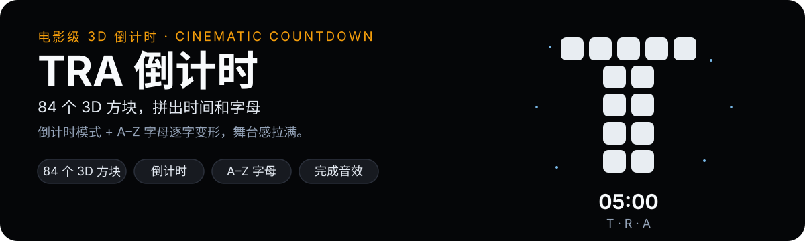
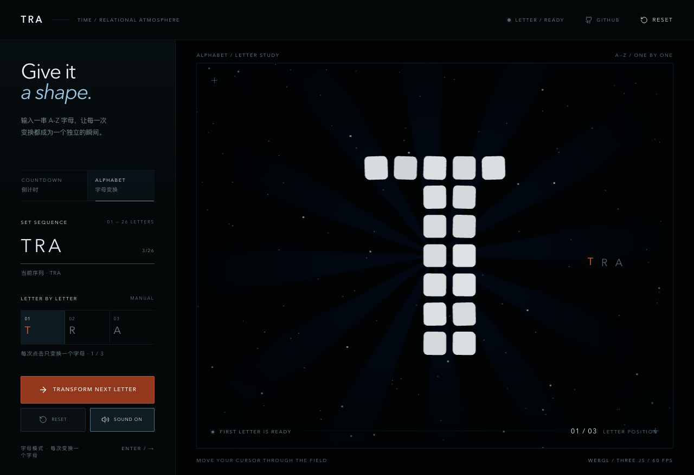

<p align="right"><a href="README.md">中文</a></p>

<p align="center">
  
</p>

<p align="center">
  <a href="https://xiaosang.cc/hotpot-timer/">▶ Try Online</a>
  ·
  <a href="https://github.com/holynova/hotpot-timer">GitHub Repository</a>
</p>

TRA Countdown is a cinematic 3D countdown timer: time and letters aren't drawn on screen — they're built from 84 rounded 3D blocks in space. As digits tick, the blocks morph and reassemble; in letters mode, one letter transforms at a time, like a presentation unfolding letter by letter. Dark stage, faint particle field, completion chime — made for hotpot timing, event countdowns, and stage demos.

## Screenshot

<p align="center">
  
</p>

## Features

- **Countdown mode**: presets of 10s / 30s / 1min / 5min, or a custom duration in seconds; Space to start/pause. Displays `MM:SS` above 60 seconds, `SS.t` (tenths of a second) below.
- **Letters mode**: enter an A–Z sequence (up to 26 letters); each step transforms a single letter (button or → key). The sequence persists in localStorage.
- **3D block morphing**: 84 rounded blocks (one InstancedMesh draw call); digits and letters each have their own dot-matrix glyph grid, and blocks interpolate to their new positions on every change.
- **Stage atmosphere**: exponential fog, ambient + directional + two point lights, a faint particle field, and English word labels beside digits (ZERO–TEN).
- **Completion chime**: plays `timer_sound.mp3` when the countdown ends, with a mute toggle; duration and letter sequence persist locally.

## Run Locally

```bash
pnpm install
pnpm dev      # Development server
pnpm build    # tsc + Vite production build
pnpm preview  # Preview the build output
```

Pure frontend app, no backend. `src/data/hotpot.ts` holds blanching times for 43 hotpot ingredients (12 meats, 8 seafood, 13 vegetables, 10 others) — not yet wired into the UI, kept as the data basis for future ingredient presets.

## Tech

- React 17 + TypeScript + Vite 2 + Three.js 0.156, Ant Design 5 + Lucide icons.
- 3D rendering lives in `TraCountdownCanvas.tsx`: RoundedBoxGeometry rounded blocks + InstancedMesh (84 instances) + Points particle background; glyphs are hand-written dot-matrix tables (`DIGIT_GRID` / `LETTER_GRID`), with digits and letters sharing the same morphing pipeline.
- State and shortcuts live in `TimerPage.tsx`: the countdown is driven by `setInterval`, Space to start/pause, → key to change letters.

```
src/App.tsx            Entry: renders TimerPage only
src/pages/TimerPage/TimerPage.tsx   Timer page: countdown / letters modes, shortcuts, sound
src/pages/TimerPage/component/TraCountdownCanvas.tsx  Three.js canvas: 84-block morphing + particle background
src/pages/TimerPage/component/AnimatedTimerBar.tsx    Progress bar component
src/data/hotpot.ts     Hotpot ingredient blanching times (43 items, not yet wired into the UI)
public/timer_sound.mp3 Completion chime
docs/                  Build output
```
