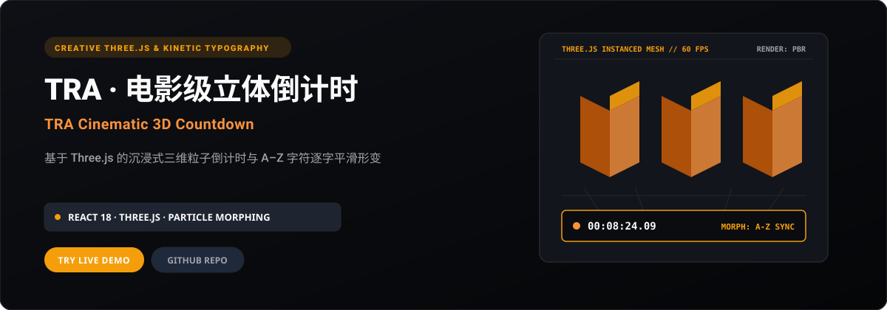
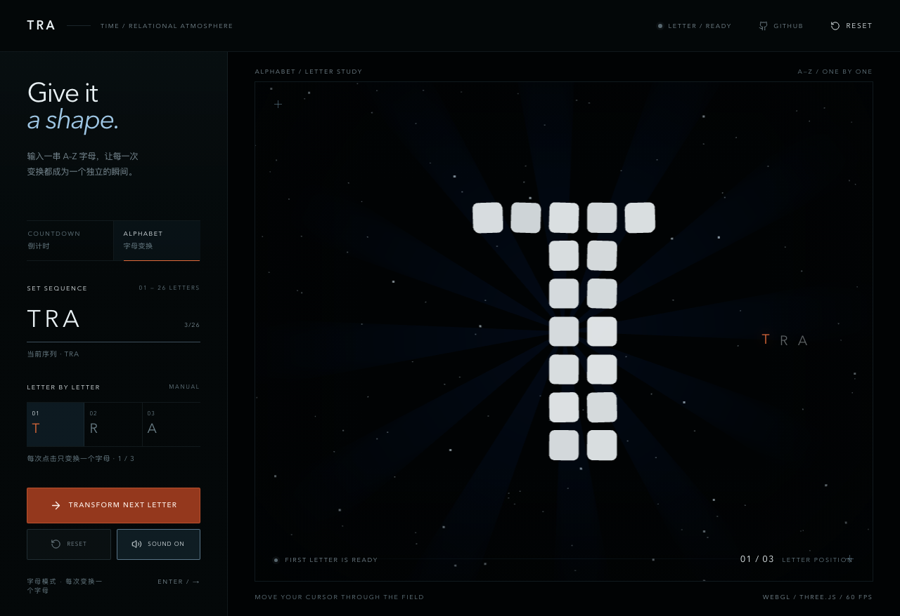

<p align="right">
  <strong>简体中文</strong> · <a href="./README.en.md">English</a>
</p>

<p align="center">
  
</p>

<p align="center">
  <a href="https://hotpot-timer.xiaosang.cc/"><strong>🌐 在线体验 (Live Demo)</strong></a> · 
  <a href="https://holynova.github.io/hotpot-timer/"><strong>🚀 备选镜像 (GitHub Pages)</strong></a> · 
  <a href="https://github.com/holynova/hotpot-timer"><strong>📦 GitHub 源码</strong></a> · 
  <a href="https://xiaosang.cc/"><strong>✨ 更多作品集</strong></a>
</p>

---

## 真实预览 (Proof of Work)

<p align="center">
  
</p>

---

## 项目简介 (What It Is)

基于 React + TypeScript + Three.js 构建的电影级三维倒计时工具。时间数字由数百个带圆角的微型三维体与动态发光粒子阵列组成，不仅支持高精度的沉浸式计时，更支持输入任意 A–Z 英文字符串，呈现震撼的逐字粒子形变与重组动效。

---

## 核心机制与特色 (Why It Matters)

- **三维粒子几何形变**：基于 SDF 距离场与三维网格采样，实现字符点阵与几何立方体间的无缝平滑插值过渡。
- **电影级工业光影系统**：多光源环境贴图、金属物理着色器 (PBR) 与全屏后处理泛光 (Bloom) 协同渲染。
- **自定义字符动态变形**：支持从数字倒计时动态无缝切入任意输入的 A–Z 词组展示，满足舞台与活动演示需求。
- **极致流畅渲染管线**：使用实例化网格 (InstancedMesh) 绘制重复几何体；实际帧率取决于设备、浏览器与场景负载。

---

## 收录清单与规格 (Inventory & Scope)

3D 倒计时模式、A-Z 字符逐字形变演示、全景自由运镜、沉浸式舞台全屏模式、深色微光粒子背景。

---

## 快速开始 (Quick Start)

### 1. 在线体验
无需安装任何环境，直接在浏览器中打开：
- 🌐 **主站演示 (Primary)**：[https://hotpot-timer.xiaosang.cc/](https://hotpot-timer.xiaosang.cc/)
- 🚀 **备选镜像 (GitHub Pages)**：[https://holynova.github.io/hotpot-timer/](https://holynova.github.io/hotpot-timer/)

### 2. 本地运行与调试
克隆仓库后执行以下命令：

```bash
git clone https://github.com/holynova/hotpot-timer.git
cd hotpot-timer
pnpm install --frozen-lockfile
pnpm dev
```

---

构建与预览：

```bash
pnpm build
pnpm preview
```

打开终端输出的地址。三维效果依赖浏览器 WebGL 支持。

## 开源协议与作者 (License & Author)

- **作者**：[holynova (小桑)](https://xiaosang.cc/)
- **授权说明**：仓库当前未附独立 LICENSE 文件；复用代码或素材前请确认相应授权。
- **合辑收录**：本仓库作为精选项目收录于 [Where Craft Lives (xiaosang.cc)](https://xiaosang.cc/)。
