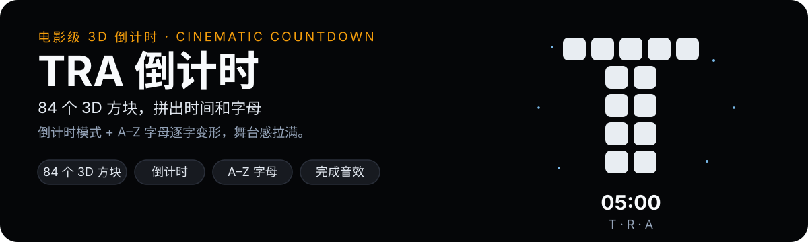
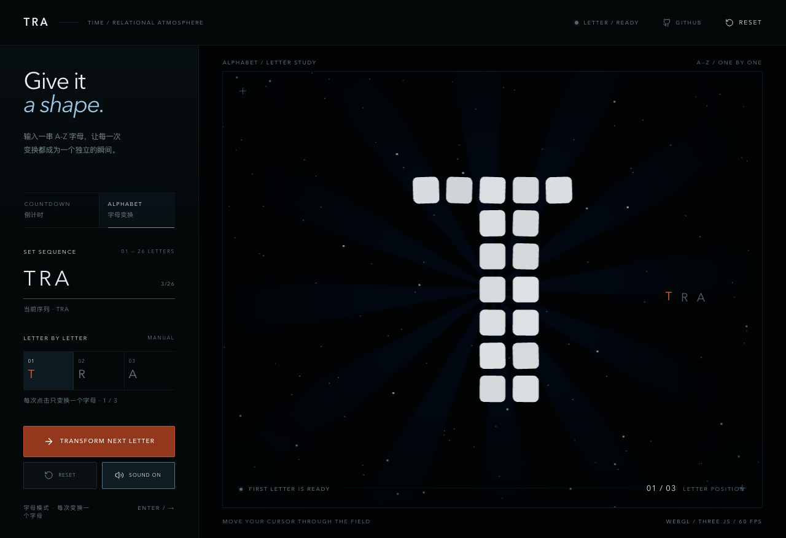

<p align="right"><a href="README.en.md">English</a></p>

<p align="center">
  
</p>

<p align="center">
  <a href="https://xiaosang.cc/hotpot-timer/">▶ 在线体验</a>
  ·
  <a href="https://github.com/holynova/hotpot-timer">GitHub 仓库</a>
</p>

TRA 倒计时是一款电影级 3D 倒计时工具：时间与字母不是画在屏幕上的字，而是由 84 个带圆角的 3D 方块在三维空间里拼出来的——数字跳动时，方块平滑形变重组；字母模式下，每次只变换一个字母，像一场逐字展开的演示。深色舞台、微光粒子、完成提示音，适合火锅计时、活动倒数与舞台演示。

## 截图

<p align="center">
  
</p>

## 功能

- **倒计时模式**：预设 10 秒 / 30 秒 / 1 分钟 / 5 分钟，也可自填秒数；空格键开始 / 暂停；60 秒以上显示 `MM:SS`，60 秒以下显示 `SS.t`（带十分之一秒）。
- **字母模式**：输入一串 A–Z 字母（最多 26 个），每次只变换一个字母（点按钮或按 → 键）；序列存在 localStorage，刷新不丢。
- **3D 方块形变**：84 个圆角方块（InstancedMesh 一次绘制），数字与字母各有一套点阵字形，切换时方块插值飞向新位置。
- **舞台氛围**：指数雾、环境光 + 方向光 + 两盏点光源、背景微光粒子；数字旁配英文单词标签（ZERO–TEN）。
- **完成提示**：倒计时结束播放提示音（`timer_sound.mp3`），可一键静音；时长与字母序列都会本地持久化。

## 本地运行

```bash
pnpm install
pnpm dev      # 开发服务器
pnpm build    # tsc + Vite 生产构建
pnpm preview  # 预览构建产物
```

纯前端应用，无后端。`src/data/hotpot.ts` 里另有一份 43 种火锅食材的涮煮时间表（肉 12 / 海鲜 8 / 蔬菜 13 / 其他 10），目前未接入界面，留作后续食材预设的数据基础。

## 技术

- React 17 + TypeScript + Vite 2 + Three.js 0.156，Ant Design 5 + Lucide 图标。
- 3D 渲染在 `TraCountdownCanvas.tsx`：RoundedBoxGeometry 圆角方块 + InstancedMesh（84 个实例）+ Points 粒子背景；字形为手写点阵表（`DIGIT_GRID` / `LETTER_GRID`），数字与字母共用同一套形变管线。
- 状态与快捷键在 `TimerPage.tsx`：倒计时用 `setInterval` 驱动，空格开始/暂停、→ 键换字母。

```
src/App.tsx            入口：只渲染 TimerPage
src/pages/TimerPage/TimerPage.tsx   计时器主页面：倒计时 / 字母双模式、快捷键、音效
src/pages/TimerPage/component/TraCountdownCanvas.tsx  Three.js 画布：84 方块形变 + 粒子背景
src/pages/TimerPage/component/AnimatedTimerBar.tsx    进度条组件
src/data/hotpot.ts     火锅食材涮煮时间表（43 种，暂未接入界面）
public/timer_sound.mp3 完成提示音
docs/                  构建产物
```
